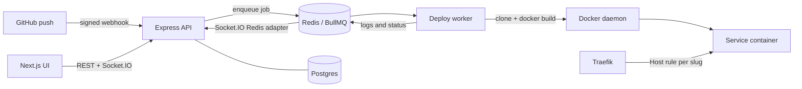

# DeployDock

A self-hosted deployment platform. Connect a GitHub repo or a Docker image, and DeployDock builds it, runs it in a container on your own server, and gives it its own HTTPS subdomain.

## Features

- Projects contain services (static site or web app), and each service has its own deployment history
- Deploy from a GitHub repo (public or private) or from a Docker image
- Every service gets a unique subdomain, `<slug>.<BASE_DOMAIN>`, routed by Traefik with wildcard HTTPS
- Auto-deploy on push through GitHub webhooks, plus manual deploys from the UI
- Build and runtime logs streamed to the UI over Socket.IO
- Per-service environment variables, build command, start command, root directory and port
- Health check before traffic switches: the new container must pass before the old one is removed
- One-click rollback to any previous deployment. If the old image is gone, it is rebuilt from the stored commit SHA
- Deploy jobs run in a BullMQ queue with 3 retries and exponential backoff
- Deployment and container metrics dashboard
- Runtime detection from the repo, or use the repo's own `Dockerfile`

## Architecture



1. A deploy is triggered manually or by a push webhook. The API verifies the HMAC signature, skips duplicate deliveries, and inserts a `queued` deployment row.
2. The job goes to the `deployments` BullMQ queue. The worker picks it up, clones the repo at a pinned commit, and builds the image.
3. The container starts with Traefik labels for `Host(<slug>.<BASE_DOMAIN>)`, a 256 MB memory limit and a restart policy.
4. After the health check passes, older running containers for that service are removed and marked `superseded`.
5. Logs and status changes are pushed to the browser through Socket.IO, using the Redis adapter so the API and workers can run as separate processes.

Each project gets its own Docker bridge network. Traefik is attached to those networks so services in different projects stay isolated from each other.

## Tech stack

| Layer              | Technologies                                                                           |
| ------------------ | -------------------------------------------------------------------------------------- |
| Frontend           | Next.js 16, React 19, TypeScript, Tailwind CSS v4, shadcn/ui, TanStack Query, Recharts |
| Backend            | Node.js, Express 5, TypeScript, Zod                                                    |
| Database           | PostgreSQL 16, Drizzle ORM (migrations run on startup)                                 |
| Queue and realtime | Redis, BullMQ, Socket.IO                                                               |
| Containers         | Docker (dockerode), Traefik v3                                                         |
| Infra              | AWS EC2, pm2 or Docker Compose                                                         |

## Design decisions

- **Queue outside the API.** Builds take minutes and can fail, so the API only creates a row and enqueues a job. Workers run as separate processes and can restart without dropping requests.
- **Job ID equals deployment ID.** Enqueueing the same deployment twice does not create a second job.
- **Webhook dedup in Redis.** GitHub delivery IDs are stored with a 24-hour TTL so a redelivered push does not trigger a second build.
- **Pinned commit SHA.** The SHA is resolved once, stored on the deployment, and used for the image tag. This is what makes rollback rebuilds reproducible.
- **Health check before cutover.** A failed deploy removes its own container and leaves the previous version running.
- **Wildcard routing, no per-service config.** Traefik reads Docker labels, so a new service needs no proxy config change.

## Project structure

```
DeployDock/
├── server/
│   ├── controllers/   request handlers
│   ├── routes/        Express routers
│   ├── service/       deploy, container and log services
│   ├── queue/         BullMQ queues
│   ├── workers/       deploy and container-action workers
│   ├── webhooks/      GitHub webhook registration and handler
│   ├── schema/        Drizzle tables and Zod schemas
│   ├── migrations/    SQL migrations
│   ├── socket/        Socket.IO server
│   ├── utils/         docker, github, domain helpers
│   └── docker-compose.yml
└── ui/
    ├── app/           Next.js routes: projects, services, deployments, logs, metrics
    ├── components/
    ├── hooks/         React Query and socket hooks
    └── docker-compose.yml
```

## Getting started

### Prerequisites

- Node.js 20+
- Docker
- PostgreSQL and Redis (the compose file runs both)
- A GitHub OAuth app. Set its callback URL to `<API_URL>/api/auth/github/callback`
- Traefik v3 running as a container named `traefik` (or set `TRAEFIK_CONTAINER`), attached to an external Docker network called `web`. For HTTPS on subdomains you need a wildcard certificate for `*.<BASE_DOMAIN>`. Traefik is not bundled in this repo.

### Environment variables

Create `server/.env`:

| Variable               | Description                                                                 |
| ---------------------- | --------------------------------------------------------------------------- |
| `PORT`                 | API port, default `3001`                                                    |
| `NODE_ENV`             | `development` or `production`                                               |
| `DATABASE_URL`         | Postgres connection string                                                  |
| `REDIS_URL`            | Redis connection string                                                     |
| `JWT_SECRET_KEY`       | Secret for signing session tokens                                           |
| `TOKEN_ENC_KEY`        | Key used to encrypt stored GitHub tokens                                    |
| `GITHUB_CLIENT_ID`     | GitHub OAuth app client ID                                                  |
| `GITHUB_CLIENT_SECRET` | GitHub OAuth app client secret                                              |
| `CLIENT_URL`           | UI origin, used for CORS, default `http://localhost:3000`                   |
| `PUBLIC_API_URL`       | Publicly reachable API URL, used as the webhook target. Cannot be localhost |
| `BASE_DOMAIN`          | Domain for service subdomains, default `localhost`                          |
| `TLS_ENABLED`          | `true` routes services through the `websecure` entrypoint                   |
| `PUBLIC_PORT`          | Public port used when building service URLs                                 |
| `TRAEFIK_CONTAINER`    | Traefik container name, default `traefik`                                   |
| `DEFAULT_APP_PORT`     | Fallback container port, default `3000`                                     |
| `POSTGRES_PASSWORD`    | Used by `docker-compose.yml`                                                |

Create `ui/.env.local`:

| Variable                  | Description                              |
| ------------------------- | ---------------------------------------- |
| `NEXT_PUBLIC_API_URL`     | API base URL                             |
| `NEXT_PUBLIC_BASE_DOMAIN` | Same value as the server's `BASE_DOMAIN` |

### Run locally

```bash
git clone https://github.com/vickynot-10/DeployDock.git
cd DeployDock

cd server
npm install
npm run dev          # API on :3001
npm run workers      # deploy and container-action workers, in a second terminal

cd ../ui
npm install
npm run dev          # UI on :3000
```

The API creates the database if it does not exist and applies migrations on startup. Workers need access to the Docker daemon.

### Run with Docker Compose

```bash
cd server
docker compose up -d --build    # postgres, redis, api, worker-deploy, worker-actions

cd ../ui
docker compose up -d --build
```

`docker-compose.yml` in both folders contains the author's domain (`deploydock.duckdns.org`) in the Traefik host rules and build args. Replace it with your own before deploying.

## API overview

| Route                                           | Purpose                                  |
| ----------------------------------------------- | ---------------------------------------- |
| `POST /api/auth/sign-up`, `sign-in`, `sign-out` | Email and password auth                  |
| `GET /api/auth/github`, `/callback`             | GitHub OAuth                             |
| `/api/projects`                                 | Project CRUD                             |
| `/api/github/repos`, `branch`, `tree`, `detect` | Repo browsing and runtime detection      |
| `/api/services`                                 | Service CRUD, deploy, start/stop actions |
| `/api/deployments`                              | Deployment history, rollback             |
| `/api/logs`                                     | Runtime logs                             |
| `/api/metrics`                                  | Deployment and container metrics         |
| `POST /webhooks/github/:service_id`             | GitHub push webhook                      |

## Limitations

- Builds and containers run on the same host as the API. There is no multi-node scheduling
- The deploy worker runs one job at a time (`concurrency: 1`)
- The workers mount `/var/run/docker.sock`, so anyone who can run code on the worker host controls Docker
- Memory is capped at 256 MB per container and is not configurable per service
- No automated tests yet

## License

TBD
