# DeployDock

Self-hosted container deployment platform. Connect a GitHub repo or Docker image, and DeployDock builds, runs, and routes it to a unique subdomain via Traefik.

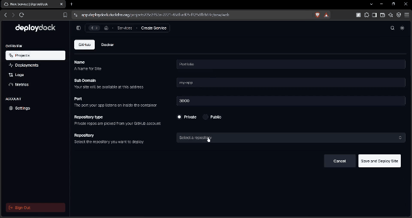

[Watch the full demo video](docs/full_demo.mp4)

---

## What It Does

- **Deploy from GitHub or Docker Hub** — point a service at a repo branch or a Docker image URL; the worker clones, builds (or pulls), and starts a container automatically.
- **Zero-downtime deploys** — the new container starts alongside the old one, must pass an HTTP health check, and only then does the old container get a graceful stop. A failed deploy leaves the previous version serving.
- **Auto-deploy on push** — registers a GitHub webhook per service; a verified `push` event to the tracked branch triggers a new deployment without any manual step.
- **One subdomain per service** — every service gets a slug-based hostname (`<slug>.<BASE_DOMAIN>`) written as Traefik labels on the container, so routing is live the moment the container starts.
- **Rollback to any past deployment** — re-queues the target deployment ID; if the original image is still cached it is reused, otherwise the worker re-clones from the stored `commit_sha` and rebuilds.
- **Suspend / resume / delete services** — container actions (stop, start, remove) are queued through a separate BullMQ queue with concurrency 5, independent of the deploy queue.
- **Live build logs and runtime container logs** — build output is buffered per deployment and stored in `deployment_logs`; running-container stdout/stderr is tailed via the Docker API and written to `service_logs` with periodic flushes.
- **Per-container metrics** — `GET /api/metrics` returns live CPU %, memory usage/limit, network rx/tx bytes, and restart count pulled directly from `dockerode`.

---

## Screenshots

| Projects                                   | Create Service                                         |
| ------------------------------------------ | ------------------------------------------------------ |
| 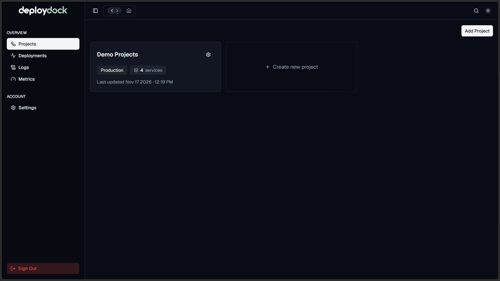 | 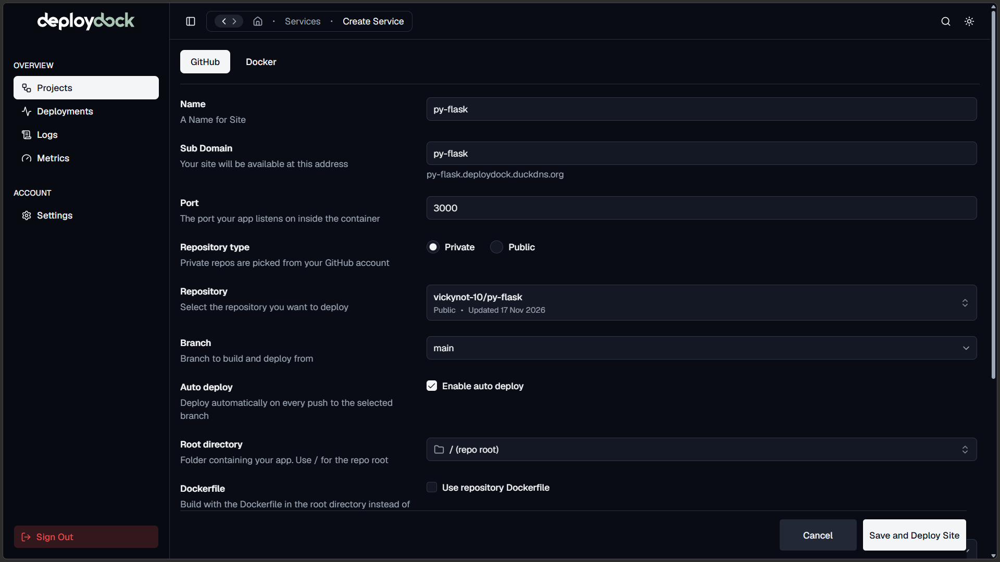 |

| Services                                   | Deployments                                      |
| ------------------------------------------ | ------------------------------------------------ |
| 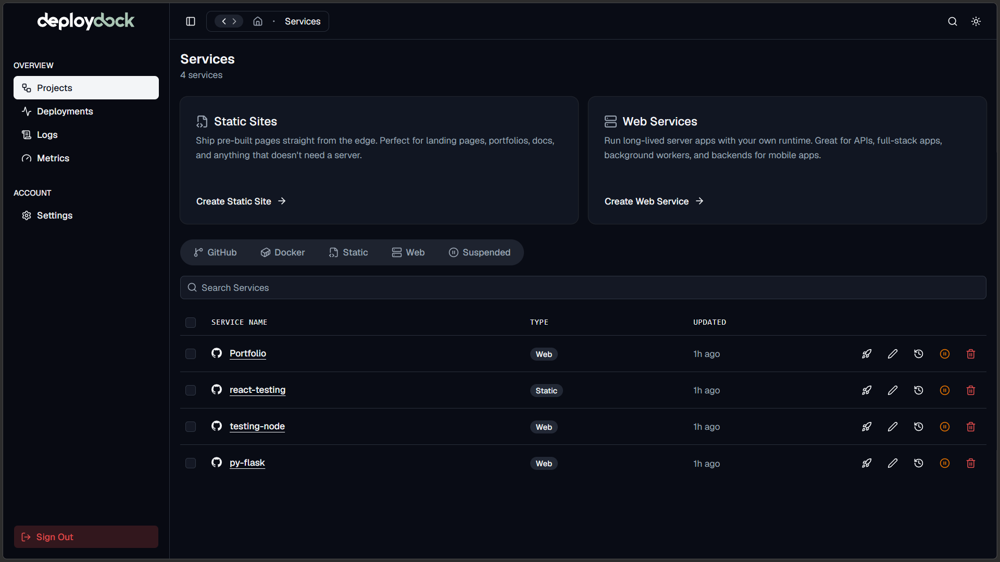 | 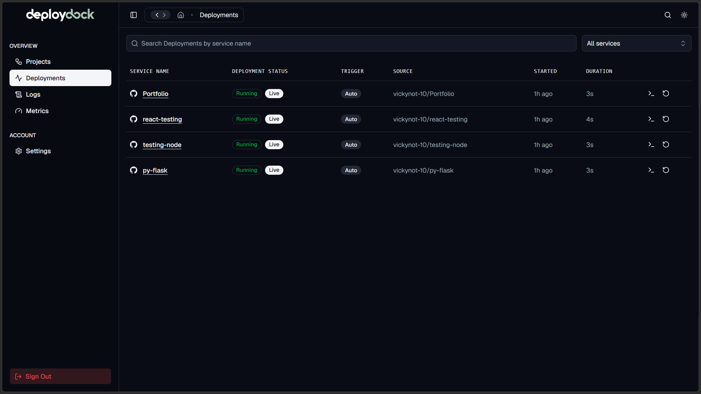 |

| Build Logs                                  | Runtime Logs                                       |
| ------------------------------------------- | -------------------------------------------------- |
| 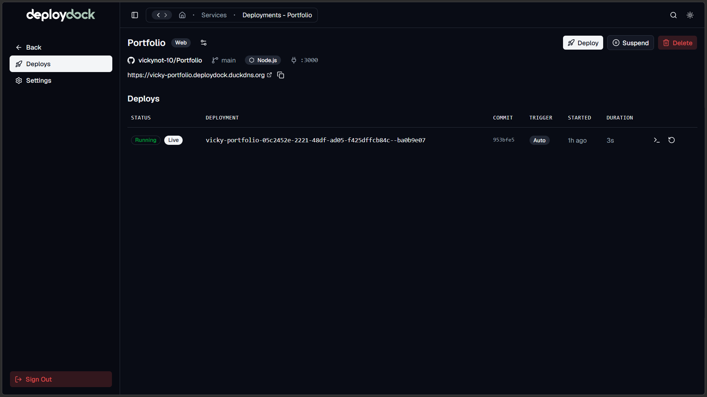 | 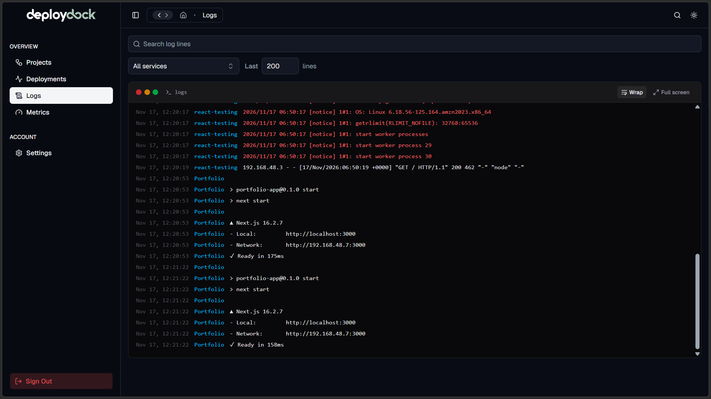 |

| Metrics                                    | Metrics (detail)                                  |
| ------------------------------------------ | ------------------------------------------------- |
| 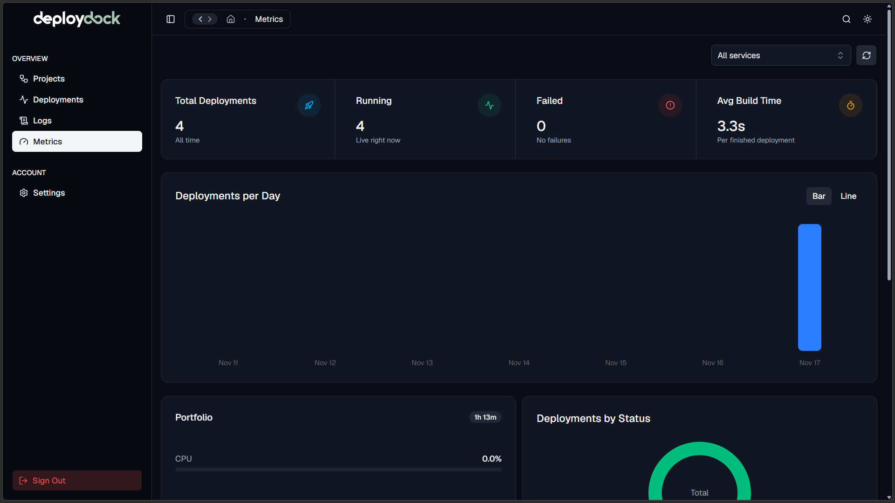 | 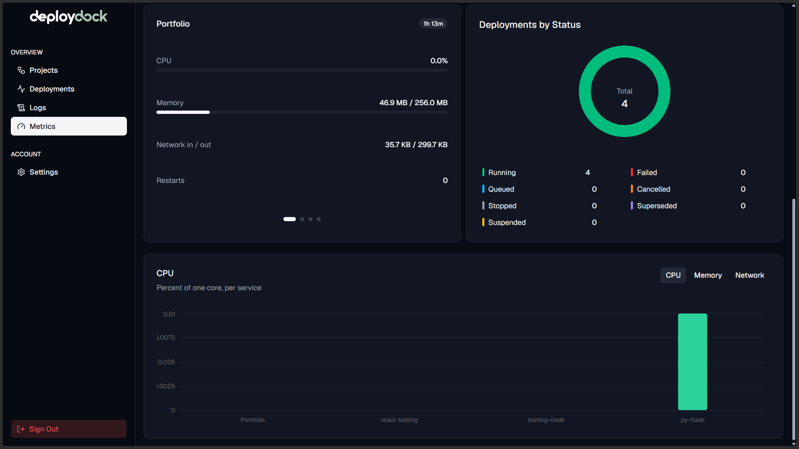 |

| Settings                                   |
| ------------------------------------------ |
| 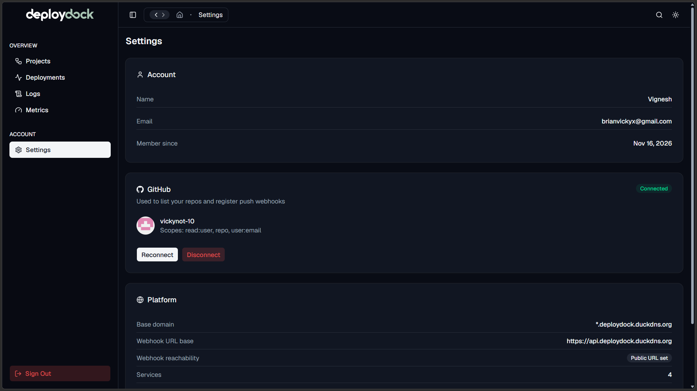 |

---

## Architecture

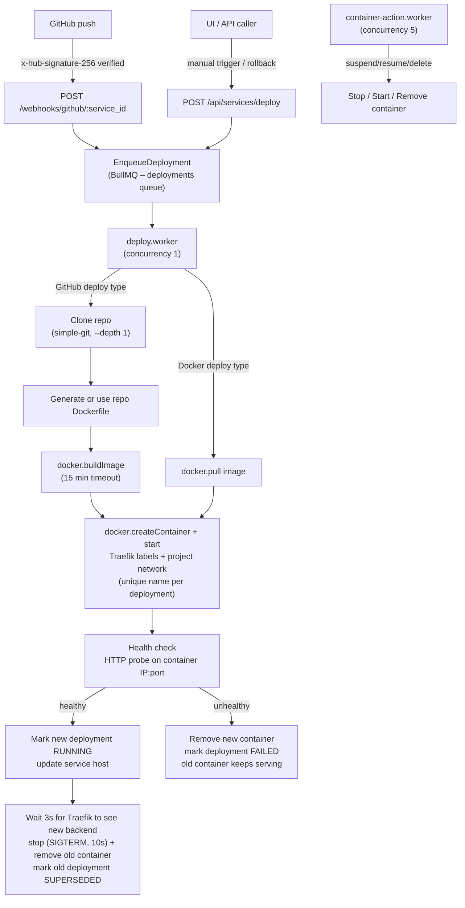

**Key path:**

1. A webhook or API call inserts a `deployments` row (status `QUEUED`) and calls `EnqueueDeployment`.
2. The deploy worker (a separate process) picks the job, sets status to `BUILDING`, clones or pulls, builds or skips build, then starts a new container under a unique per-deployment name and health-checks it. If healthy, it marks the deployment `RUNNING`, updates the service host, waits briefly for Traefik to register the new backend, then gracefully stops and removes the previous container. If unhealthy, only the new container is removed and the old one keeps serving.
3. Traefik is already connected to the per-project bridge network and reads container labels with no reload needed.
4. Status changes are emitted to Socket.IO rooms (`service:<id>`, `deployment:<id>`) via a Redis adapter so the UI updates in real time.

---

## Tech Stack

| Layer             | Technology                                                                                  |
| ----------------- | ------------------------------------------------------------------------------------------- |
| API server        | Express 5, TypeScript, Socket.IO                                                            |
| Queue / workers   | BullMQ 6 (Redis-backed), two separate worker processes                                      |
| Database          | PostgreSQL 16 via Drizzle ORM, `drizzle-kit` migrations                                     |
| Cache / broker    | Redis 7 (ioredis), Redis adapter for Socket.IO                                              |
| Container runtime | Docker Engine via `dockerode`                                                               |
| Reverse proxy     | Traefik (label-based, wildcard subdomain routing)                                           |
| Auth              | JWT in httpOnly cookie, bcrypt passwords, GitHub OAuth                                      |
| UI                | Next.js 16, React 19, TanStack Query, Socket.IO client, Recharts, shadcn/ui, Tailwind CSS 4 |

---

## Key Design Decisions

**Workers run as separate processes, not inside the API**
`deploy.worker.ts` and `container-action.worker.ts` are started independently (`npm run workers`). Long-running Docker builds and the 15-minute build timeout cannot block the HTTP process. Workers can be restarted independently without taking down the API.

**Zero-downtime deploys via overlapping containers**
Each deployment gets its own container name (`<slug>-<project_id>--<deployment_id[:8]>`) with identical Traefik router and service labels, so Traefik load-balances across old and new during the overlap. Traefik's own health check (2s interval) keeps traffic off the new container until it is ready. The old container is only stopped after the new one passes the worker's health check, is recorded as `RUNNING`, and a 3s grace period has passed. Old containers get `SIGTERM` with a 10s timeout rather than `SIGKILL`, so in-flight requests can finish. Cleanup errors after the swap are logged, not thrown, so they cannot take down the healthy new container.

Because both containers briefly share the same network alias, services that cannot run two instances at once (queue consumers, startup migrations) will overlap during the swap.

**Traefik label-based routing, no config reload**
Each container is created with `traefik.http.routers.<slug>.rule=Host(...)` labels and connected to a per-project bridge network (`project_<project_id>_network`). Traefik watches the Docker socket and picks up the route immediately. No static config file is written or reloaded. `TRAEFIK_CONTAINER` tells the code which container to connect to each project network.

**Rollback rebuilds from `commit_sha` when the image is gone**
`deployments.image_tag` and `deployments.commit_sha` are persisted per deployment. On rollback, `IsImageExists(target.image_tag)` is checked first. If present the image is reused directly. If not, `CloneRepo` is called with the specific SHA (`git fetch --depth 1 origin <sha>`) and the image is rebuilt from that exact commit. Docker-image-based deployments skip the rebuild path and always re-pull.

**Webhook delivery deduplication via Redis**
The GitHub webhook handler stores each `x-github-delivery` ID in Redis with a 24-hour TTL (`gh_delivery:<id>`) using `SET NX`. Duplicate deliveries (GitHub retries) are dropped before a deployment is queued.

---

## Local Setup

### Prerequisites

- Docker Engine running on the host
- Node.js 20+
- A running Traefik container named `traefik` (or override `TRAEFIK_CONTAINER`)

### 1. Start infrastructure

```bash
docker run -d --name redis -p 6379:6379 redis:7-alpine
docker run -d --name postgres \
  -e POSTGRES_USER=dockhand \
  -e POSTGRES_PASSWORD=password \
  -e POSTGRES_DB=dockhand \
  -p 5432:5432 postgres:16-alpine
```

### 2. Server

```bash
cd server
cp .env.example .env   # fill in values from the table below
npm install
npm run dev            # API on :3001 — runs migrations on startup
```

In a second terminal:

```bash
cd server
npm run workers        # starts deploy + container-action workers concurrently
```

### 3. UI

```bash
cd ui
cp .env.example .env
npm install
npm run dev            # Next.js on :3000
```

### Server environment variables

| Variable               | Required | Description                                                                           |
| ---------------------- | -------- | ------------------------------------------------------------------------------------- |
| `DATABASE_URL`         | ✅       | Postgres connection string                                                            |
| `REDIS_URL`            | ✅       | Redis connection string                                                               |
| `JWT_SECRET_KEY`       | ✅       | Secret used to sign JWT tokens                                                        |
| `TOKEN_ENC_KEY`        | ✅       | Hex key used to AES-encrypt stored GitHub tokens                                      |
| `CLIENT_URL`           | ✅       | URL of the UI (CORS origin)                                                           |
| `PUBLIC_API_URL`       | ✅       | Publicly reachable API URL — used as the GitHub webhook target; must not be localhost |
| `GITHUB_CLIENT_ID`     | ✅       | GitHub OAuth app client ID                                                            |
| `GITHUB_CLIENT_SECRET` | ✅       | GitHub OAuth app client secret                                                        |
| `GITHUB_CALLBACK_URL`  | ✅       | OAuth callback (`<PUBLIC_API_URL>/api/auth/github/callback`)                          |
| `BASE_DOMAIN`          | ✅       | Root domain for subdomains, e.g. `example.com`                                        |
| `TLS_ENABLED`          | —        | Set to `"true"` to use the `websecure` Traefik entrypoint and `https://` URLs         |
| `PUBLIC_PORT`          | —        | Port suffix in generated URLs (defaults to 443 or 80 based on `TLS_ENABLED`)          |
| `TRAEFIK_CONTAINER`    | —        | Name of the Traefik container (default: `traefik`)                                    |
| `DEFAULT_APP_PORT`     | —        | Fallback container port when a service has none set (default: `3000`)                 |
| `PORT`                 | —        | API listen port (default: `3001`)                                                     |
| `NODE_ENV`             | —        | Set to `production` to enable secure cookies                                          |

### UI environment variables

| Variable                  | Required | Description                                        |
| ------------------------- | -------- | -------------------------------------------------- |
| `NEXT_PUBLIC_API_URL`     | ✅       | Full URL of the API server                         |
| `NEXT_PUBLIC_BASE_DOMAIN` | ✅       | Base domain shown in the UI for subdomain previews |

---

## Project Structure

```
dockhand/
├── server/
│   ├── app.ts                        # Express entry, migrations, Socket.IO init
│   ├── constants.ts                  # Deployment statuses, deploy types, runtimes
│   ├── workers/
│   │   ├── deploy.worker.ts                      # BullMQ worker entry (deploy queue)
│   │   ├── deploy-process.worker.ts              # GitHub / Docker / rollback logic
│   │   ├── container-action.worker.ts            # BullMQ worker entry (actions queue)
│   │   └── container-action-process.worker.ts    # Stop / start / remove container
│   ├── queue/
│   │   ├── deploy.queue.ts           # deployments queue, 3 attempts, exponential backoff
│   │   └── container-actions.queue.ts
│   ├── service/
│   │   ├── deploy.service.ts         # DockerBasedDeploy, GithubBasedDeploy, old-container cleanup
│   │   ├── docker-logs.service.ts    # Runtime log tailing → service_logs
│   │   └── deploy-logs.service.ts    # Build log buffering → deployment_logs
│   ├── webhooks/
│   │   └── github.webhook.ts         # Webhook registration, HMAC verify, delivery dedup
│   ├── utils/
│   │   ├── docker.ts                 # dockerode wrappers, RunContainer, health check
│   │   ├── github.ts                 # Clone repo, Dockerfile generation, docker.buildImage
│   │   ├── domain.ts                 # BuildHostName, BuildPublicUrl, slug validation
│   │   └── containerStats.ts         # CPU, memory, network snapshot
│   ├── controllers/                  # Route handlers
│   ├── routes/                       # Express routers
│   ├── schema/database/              # Drizzle table definitions
│   └── docker-compose.yml            # Production compose (api, two workers, pg, redis)
└── ui/
    ├── app/                          # Next.js app router pages
    ├── components/                   # UI components (shadcn/ui base)
    ├── hooks/                        # TanStack Query hooks, socket hooks
    └── utils/                        # axios instance, socket client, queryClient
```

---

## Roadmap

Items not built in the current code:

- [ ] Multi-user / team access — services are scoped to a single `user_id` with no sharing
- [ ] Custom domains — only `<slug>.<BASE_DOMAIN>` is supported; no CNAME / custom domain flow
- [ ] TLS certificate provisioning — `TLS_ENABLED` switches Traefik to `websecure` but Let's Encrypt / ACME config is not in this repo
- [ ] Log retention / pruning — `service_logs` and `deployment_logs` grow without a cleanup job
- [ ] Build caching — each GitHub deploy does a full clone with no dependency or layer cache between builds
- [ ] Deploy preview URLs — no branch-preview or PR-based deployment path
- [ ] Per-service deploy strategy — zero-downtime overlap is the only mode; no stop-then-start option for single-instance apps
- [ ] Orphan tracking — `container_name` is saved only after the health check passes, so a worker crash mid-deploy can leave an untracked container

---

## Uncertainties

> Things that could not be confirmed from the code alone:

- **Traefik wildcard TLS config** — `docker-compose.yml` uses the `websecure` entrypoint for the API route, implying a wildcard cert is configured externally; that configuration is not in this repo.
- **`DEPLOY_NETWORK` env var** — present in `.env` but not referenced in any TypeScript source file found; may be unused or intended for a future Traefik `--providers.docker.network` override.
- **Health check on non-Linux hosts** — `HealthCheckCOntainer` only does an HTTP probe on Linux (`process.platform === "linux"`); on macOS/Windows it waits 8 seconds and assumes healthy, which may give false positives in development.
- **`kafkajs` dependency** — installed in `package.json` but no import was found in any source file; unclear if planned or leftover.
- **UI package name** — `ui/package.json` has `"name": "Fillire"`, not DeployDock; the UI appears to be from a renamed or repurposed project.
